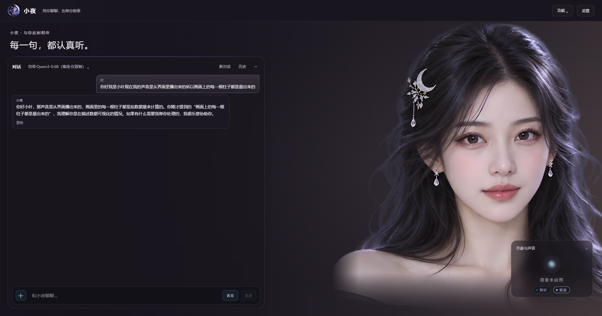
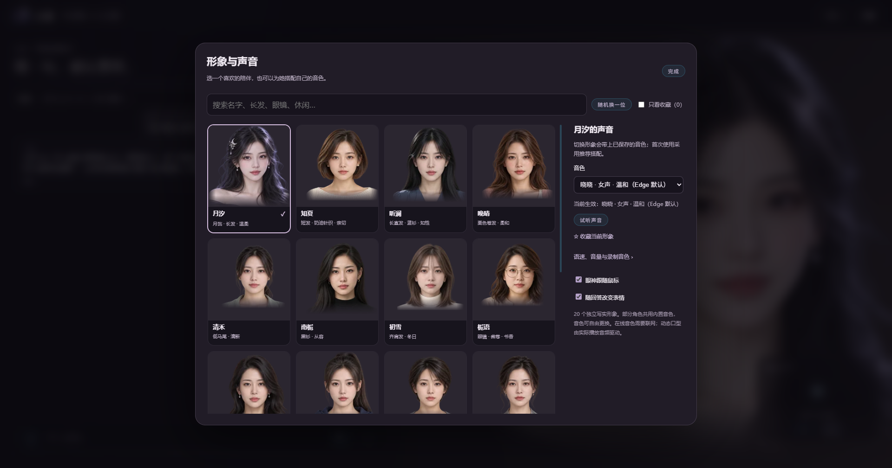
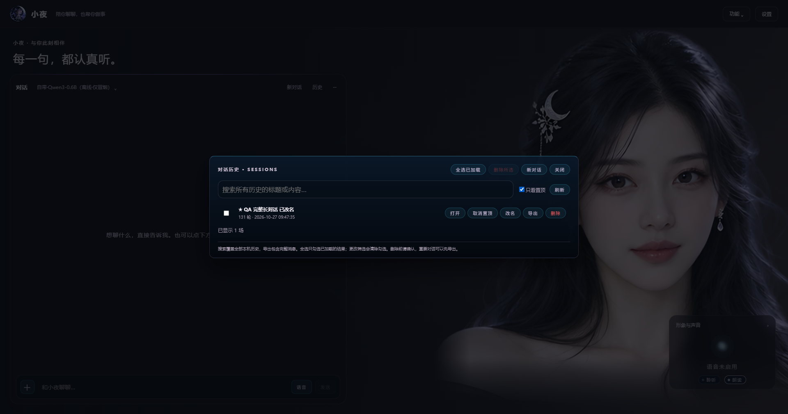

# 小夜 · 桌面 AI 助手


一个跑在自己机器上的桌面助手：简洁对话主页、低饱和写实动态人物背景和可选桌面宠物，打字和说话两条入口都能用。
技术形状是 **pywebview + WebView2 + Vue 3 + Pinia**，语音、视觉、系统操作都在同一个 Python 进程里。

**r129 / Android 0.9.1（16）**：历史支持标题和正文搜索、命中片段、分页加载、置顶与只看置顶；长对话导出完整消息，旧会话也保留正确标题。减少历史列表和后台状态刷新中的数据库查询，并修复历史弹窗被聊天区域裁切的问题。人物动画、形象收藏、4K 画布及本地媒体功能保留。完整买家包附带本地图片/视频引擎、Python、生成模型、离线语音识别权重及固定版 WebView2。使用条件及验证范围见 [r129 交付说明](docs/交付说明-r129.md)。







本轮方案、性能基准及验收步骤见 [优化与验收方案](docs/优化与验收方案-r129.md)；交付说明记录当前门禁、独立 ZIP 校验和解压运行结果。历史轮次的测试数与文件哈希不代替当前包验收。

生图与本地视频支持多语言描述：对话工具和弹窗共用整句翻译，**优先用软件自己的模型（随包本地模型即可，无需额外 key、离线可翻），本地模型不可用时退到国内联网翻译（阿里云通义千问为主、百度备，多家自动兜底）；输入已是英文则直接跳过翻译**，保留原文与实际英文译文；
翻译失败会停止提交。视频使用 AnimateDiff 与生图共用 ComfyUI，分辨率、帧率、时长、步数都可调，
默认按本机显存自动选短视频档（4GB 显卡＝256×256、8 帧/秒、2 秒），手动可拉到 512×512、24 帧/秒、
最长 32 秒（超显存会截到能装下的帧数并写明）。视频弹窗有「自动 / 只用本地 / 只用云端」三档引擎，
默认本地；云端那条是多家可自填的异步「文生视频」（提交→轮询→下载），出厂默认按阿里通义万相预置、
复用已有的 `DASHSCOPE_API_KEY`，换别家照它文档逐格改。买家版凭据使用当前 Windows 用户的 DPAPI 加密保存，模型、缓存与引擎放在非系统盘。
安装与验证见 [本地图片和视频](docs/本地图片和视频.md)。

本地模型支持免 Key 联网检索和带来源的知识库积累；右击历史提问可修改后另建分支重问，原记录保留。
0.6B 档在联网和明确询问知识库时展示来源片段，避免自行编造榜单与年份。知识库可以重启后检索，
自动积累的是公开来源资料，模型权重不会因此改变。买家版数据独立放在 `小夜/用户数据/`，不继承作者配置或密钥。

**没有账号系统、没有遥测上报、没有云端同步。** 对话历史、记忆、用量、操作审计全在
`JARVIS_HOME` 指向的数据目录里（一个 SQLite + 几个 JSONL）；删掉那个目录就等于彻底清除。

## 能干什么

- **对话**：多会话、逐 token 流式、随时掐掉正在思考的一轮、可以贴图片问、多个模型圆桌协作
- **语音**：唤醒词（可自己在界面上改）、聆听/朗读开关、录一段自己的声音做音色（云端复刻，默认不上传）
- **动手**：查询进程与资源占用排行、垃圾清理（**只扫描列出，删除要人逐条勾选确认**）、定时提醒
- **界面**：可换皮肤与动作、桌面宠物（思考/说话时她有自己的动画）、手机接入同一套能力
- **接模型**：任何 OpenAI 兼容端点都能接；**本机的 Ollama / LM Studio / llama.cpp 支持免 API Key 直连**
  （设置里点一下填好地址，勾「这个端点不需要 API Key」，保存时会自动实测一次，连不上就整行退回并说原因）

## 从哪里读起

| 想干什么 | 看哪份 |
|---|---|
| 先搞清楚这是什么、边界在哪 | [`docs/总览.md`](docs/总览.md) |
| 跑起来（源码 / 打包产物 / 快捷键） | [`docs/桌面运维手册.md`](docs/桌面运维手册.md) |
| 分层与模块怎么切 | [`docs/架构分层.md`](docs/架构分层.md) |
| 工具与能力清单 | [`docs/工具链.md`](docs/工具链.md)、[`docs/AI能力规划.md`](docs/AI能力规划.md) |
| 多模型协作那一层 | [`docs/桌面多模型协作.md`](docs/桌面多模型协作.md) |
| 音色与录音复刻 | [`docs/声音克隆.md`](docs/声音克隆.md) |
| 手机侧 | [`docs/手机版规划.md`](docs/手机版规划.md) |
| 手机 AI 工作台、提示词、笔记与会话管理 | [`docs/手机端功能扩展-2026-10-16.md`](docs/手机端功能扩展-2026-10-16.md) |
| 手机 0.5.0 新功能与使用方法 | [`docs/手机端扩展-0.5.0.md`](docs/手机端扩展-0.5.0.md) |
| QQ 机器人 / 服务器中转 | [`docs/QQ机器人.md`](docs/QQ机器人.md)、[`docs/服务器部署.md`](docs/服务器部署.md) |
| 分发、数据与隐私边界 | [`docs/分发与分享.md`](docs/分发与分享.md) |

## 已知没做到的部分（写在这里，不藏在文档里）

- **实际本地推理和免 Key 联网已验证**：使用随包 llama.cpp/Qwen3-0.6B 真实进程完成搜索、带来源入库，重开数据库后新对话能够检索；不能据此声称验证了所有 Ollama/LM Studio 版本。不同主机、干净 Windows 用户及全部低配模型档仍待验证。
- **离线音色复刻在本机跑不动**（模型环境缺失），界面按真话显示不可用；云端复刻没拿真 Key 端到端跑过。
- **视频云端 API 只验到契约层**：异步「文生视频」链路（提交→轮询→下载）用离线假端点跑通，默认档按阿里通义万相的公开契约预置，但本轮没有可用的 `DASHSCOPE_API_KEY` 账号密钥、**没拿真账号跑过一次真视频**（与云端复刻、生图云端同口径）。
- `llm.timeout_seconds` 是全局默认值；每个服务商可用 `timeout_seconds` 覆盖。本机冷启动仍可能较慢。
- OCR/截图和 Playwright 有底层实现，但没有接入当前聊天工具表；不要把“传图问答”说成“自动读屏操作”。
- ASR 目前是 SenseVoice/FunASR 整段识别；默认 Edge-TTS 需要联网。工作流的 EVENT 触发尚未接事件总线。

## 快速开始

```bash
python -m venv .venv && .venv\Scripts\activate
pip install -e ".[desktop]"
python -m jarvis --desktop        # 界面 + 托盘 + 热键
```

作者版桌面 API Key 仍使用环境变量（当前进程 + Windows 用户环境）；买家版使用当前 Windows 用户的 DPAPI 加密文件，搬到其他用户或电脑后需重新填写。
Android 0.4.2 起模型配置/配对令牌走 **Android Keystore + AES-GCM**，自动迁移旧 Preferences；
网页预览仍为普通本机存储，不应填写真实密钥。对话请求会发送到用户配置的模型端点。

## 这个仓库

公开仓库只有 `main` 这一个分支的内容对外，它是私有开发分支去掉商业材料（报价、能力清单、
需求确认单）之后的同一棵树。所以这里的提交历史会成批出现，而不是逐条开发记录。


## 检测与交付

本轮问题、修复、回归和真实设备边界见 [全面检测与优化](docs/全面检测与优化_2026-10-08.md)。
最近复审与剩余优化项见 [r120/r121 审查记录](docs/r119复审与r120修复-2026-10-15.md)。

- `python -m jarvis --self-check`：只读资源/依赖/内存数据库与无网络对话自检，不打开用户数据或麦克风。
- 已打包 exe 可用 `--self-check-json <文件>` 导出相同报告，便于验收实际产物而非仅验源码。
- 交付入口委托给版本管理内的 `scripts/deliver_release.ps1`；先验证 PC、签名 APK 与源码内容指纹，
  再原子生成 ZIP、独立 CRC/SHA256 回读。只有通过后才允许更新快捷方式和清理旧包。
- 界面截图通道或 Android 真机不可用时，验收报告明确标注，自动测试不能替代设备验收。
