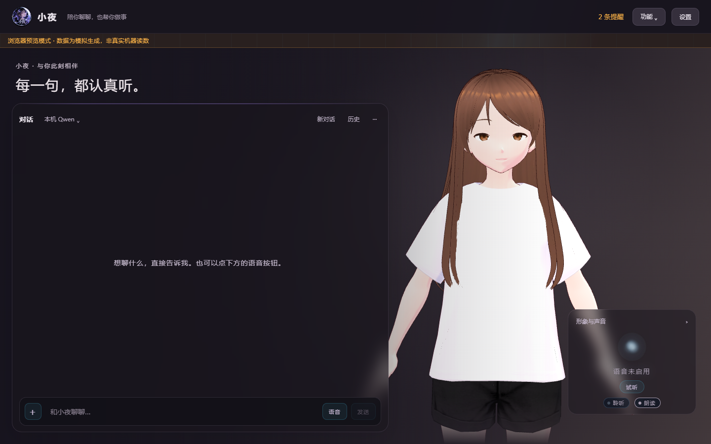

# r130：3D 形象、找回的功能入口与界面排版

2026-10-27 实施并交付。桌面 r130，Android 继续使用源码未变的 0.9.1（16）。

## 使用方式

- 主页形象默认为 **3D 角色**：口型把实际播放音频的五个频段映射成圆唇/扁唇/开口五档（实测低频圆唇度约为高频的 7 倍，嘴型有形状变化），眨眼是约 0.19 秒的连续开合曲线（不再是整帧硬切），头部跟随鼠标并在停视后收回，聆听/思考/说话各有姿态。「形象与声音」里可一键切回 20 个写实照片；照片方式的口型/眨眼/表情机制不变。
- 显卡开不了 3D 或模型文件缺失时自动退回照片形象，并在画面上说明原因，不再静默空白。
- 「功能」面板新增一级入口：**长期记忆、知识库、自动化**（直达「提醒与助手」弹窗对应页签）、**对话历史、用量**。这五个功能后端一直在，是 r124 改版时把可搜索文案里的关键词弄丢了；现在 14 个关键词有契约测试钉住，少一个门禁就红。
- 命令面板重排为两列纵向流（按两列高度差最小切分，实测 623/640 px）；对话区放大态的「关闭」跟工具条排尾走，不再压住「···」。

## 修复

- 告警/提醒条目原来一行截断，实测「C:\ 可用只剩 8.0 GB…」被截掉 128 px、「CPU 已经连着占用 93%…」截掉 138 px；改成最多两行 + 悬停看全文。用量图例的模型名同样补上悬停全文。
- 「想做什么？」面板的列错位、底部大片空白、按钮被挤压换行、硬编码配色不吃皮肤，一并修掉。
- 3D 驱动源复用宠物窗已验证的 `FaceDriver`（频段→口型、指针跟随、连续眨眼），主界面此前只接了纯音量贴片。

## 当前验收记录

开发窗口已验证：3D 模型加载与半身取景（人物占画面 29.9%）、静音闭嘴、五档口型随音频动且形状分化（低频圆唇度 2.8 vs 高频 0.4）、眨眼连续开合（10 个不同开合度）、照片↔3D 双向切换、19 张弹窗几何（横向溢出/截断/重叠/列错位/底部留白，23 项全绿）、放大态按钮 rect 重叠为 0、知识库/记忆入口逐字落到对应页签。

- 正式门禁：4022 passed / 5 skipped；Black、Ruff、mypy 412 个文件通过，前端 36 项单元测试及构建通过。凭据 `reports/gates-r130.json`。
- 几何审计：`reports/layout-audit/layout-audit.json`（23 项）；3D 实机验收：`reports/stage3d/stage3d.json`（10 项）；品牌/口型/20 形象回归：14 项全过。
- 构建源码 `0054a03c200932d48a3dfb0a44b9b9962d6c997b`，源码指纹 `856259f835b24b286a01b689ada2bc1a9af44d1ddba5778f4b31135291ed5232`。
- 完整包 `小夜-电脑+手机-r130.zip`：17,896,206,866 字节（17,067.2 MiB），54,682 条目，全 CRC 回读通过，错误列表为空。
- ZIP SHA256：`a51b866e18b97fe8591835252fcc33f7f57507b24027c832395c45cb204a98a4`。
- EXE SHA256：`a294b239d952a9f1d56d1d18a96aea269d144ae72c71cac42032c34128bf571e`。
- APK SHA256：`df06dd504419995dbd2bc83460c90ad1749811f3fca779d3e4c6a569c732226a`（与 r129 相同，手机源码未变）。
- 包内产物抽查：主界面 chunk 含 `__xiaoYeStage` / `3D 角色` / `长期记忆` / `知识库` 等标记串，随包 VRM 模型在 `小夜/_internal/jarvis/ui/web/avatar/小夜.vrm`。桌面快捷方式已读回指向 r130 产物。

## 已知边界

- 随包只有一个 VRM 模型（白 T 恤黑短发女孩），与 20 张写实照片的人物设定不同；换形象需要另备 VRM 文件放入 `avatar/` 目录（优先级 `小夜.vrm` → `xiaoye.vrm` → `model.vrm`）。
- 3D 常驻渲染在静置时约 7 fps、说话 30 fps；「减少动态效果」开启时停止头动与眨眼，保留口型。
- 设置弹窗在无后端的浏览器预览模式下内容为空壳，几何审计对它的覆盖以真实运行环境为准。
