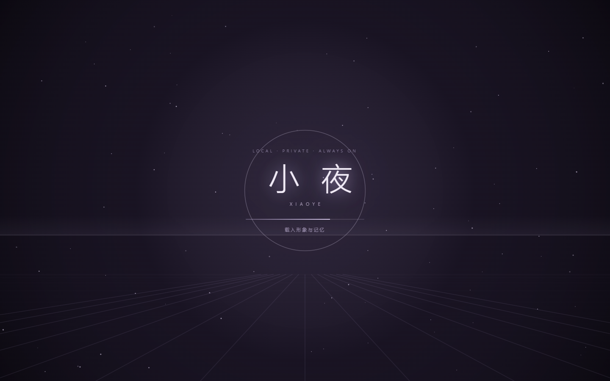

# r131：写实形象动效重做与开机动画

2026-10-28 交付。桌面 r131，Android 继续使用源码未变的 0.9.1（16）。

## 这一轮为什么把 r130 的 3D 撤了

r130 把主界面换成了 VRM 3D 角色，用户看过实际效果后的判断是"真丑"，要求回到原来那 20 个写实形象。**问题不在那张脸，在它动起来的方式**——每一帧单拿出来都自然，连起来就露馅。所以 r131 恢复写实形象，把动效算法重做，3D 相关代码、偏好字段、面板文案全部删除。

## 使用方式

- 开机：双击后有约 2.5 秒的启动动画——粒子从四周汇聚、透视网格向前推进、扫描线掠过、「小夜」逐字浮现并收拢字距，然后淡出进主界面。`index.html` 里垫了一层静态版，从双击到第一帧之间没有白屏。系统开启「减少动态效果」时直接跳过。
- 形象：主页右侧仍是那 20 个写实角色，口型跟着实际播放的音频动，眨眼、眼神、表情都可单独关闭（「形象与声音」里）。

## 动效改了什么

- **眨眼**。原来是"睁眼"和"闭眼"两帧之间 190 ms 硬切，没有中间帧，所以是闪一下。现在按真实眼睑运动做：75 ms 闭合 + 135 ms 睁开，且闭合不是换图，是把眼睛上方那条**皮肤**向下拉伸盖住眼睛；闭到最深时才用随包的闭眼贴片补眼线和睫毛。几何负责连续，贴片负责细节。
- **眼神**。原来把眼睛区域切成 4×8 块逐块推拉，那是拉伸原图像素，所以糊。现在整块平移、幅度为眼宽的 5%，椭圆裁掉边缘——移动不是变形。
- **口型**。四档下颌贴片仍按音量取相邻两档做线性混合（贴片只在下颌与嘴部有像素，混合在数学上就是插值，不会叠出第三张嘴），但多了一道 60 ms 低通：RMS 每帧都在抖，不滤的话嘴在以 30 Hz 抽搐。
- **表情**。说话时不再被清零，只压低到 45%——一张"说话时笑容消失"的脸比错一帧口型更假。

## 当前验收记录

- 正式门禁：**4021 passed / 5 skipped**；Black、Ruff、mypy 412 个文件通过，前端单元测试与构建通过。凭据 `reports/gates-r131.json`。
- 动效验收 7 项（`scripts/verify_portrait_motion.mjs`，证据在 `reports/r131/portrait-motion/`）：启动页出现过且 5 秒内让位、静音闭口为 0.000、眨眼 8.8 秒内采到 4~6 个半闭中间态、嘴最大张合 0.99、闭眼帧与张嘴帧都抓到真画面、表情通道生效。
- 品牌与语音回归 14 项（含真实 Edge-TTS 合成 PCM 驱动口型、打断立即闭嘴、20 个形象逐个加载、眼神双向跟随、放大态关闭）；弹窗几何审计 23 项（横向溢出 / 文字截断 / 按钮重叠 / 列错位 / 底部留白）全绿。
- 一条判据在标定后**删掉**了：原本想断言"相邻 40 ms 的口型跳变小"，但去掉低通的对照版是 15 次大跳、当前实现是 12 次——分不开，留着就是一条会绿的假判据。现在只记读数、不设阈值，"嘴不抽搐"交给上面两张真画面由人眼看。

## 产物

- 源码 `6cbb7c3`，源码指纹 `d144326be78ba5a0f5171bbf2daf260ab7dd21ce44bb3e2472aa3437cbc904db`。
- 完整包 `小夜-电脑+手机-r131.zip`：17,896,205,542 字节（17,067.2 MiB），54,682 条目，全 CRC 回读通过，错误列表为空。
- ZIP SHA256：`5cf903e3dd91695ed02c19028543c4520d1b47633f61d6390aead57c2e16bcd5`。
- EXE SHA256：`4200a4bad8af359e39e88d3385e72ed6b3c2eab58ddd1318b92d61a1e1bd1b9a`。
- APK SHA256：`df06dd504419995dbd2bc83460c90ad1749811f3fca779d3e4c6a569c732226a`（与 r129/r130 相同，手机源码未变）。
- 包内抽查：主界面 chunk 含 `splash__title` / `20 个写实形象` / `长期记忆` / `__jarvisOpenSessions`，**不含** `__xiaoYeStage` 或「3D 角色」字样；买家文档标题已改成不带轮次的「小夜 · 安装与使用」。
- 公开仓库已同步：`75d86b9`（公开树 1144 文件、`commercial` 条目 0、密钥扫描只命中测试里那枚明确的假钥匙）。桌面快捷方式已读回指向 r131 产物。

## 其它

- 交付 bat 修了三处：路径不再带 `闲鱼展示内容\..`、加了项目根检查、失败时给常见原因并提示别发旧包，成功后自动打开交付目录。两份副本（`scripts/templates` 与卖家目录）保持字节一致，有测试钉着。
- 门禁的 pytest 现在带 `--basetemp`（固定到 D 盘）：之前「买家版不许装系统盘」那条会因临时目录落在 C 盘而偶发地红，红的是临时目录不是代码。
- 旧构建目录 r129/r130（37 GB）与旧的崩溃日志已清理；只保留 r131 的构建根。
